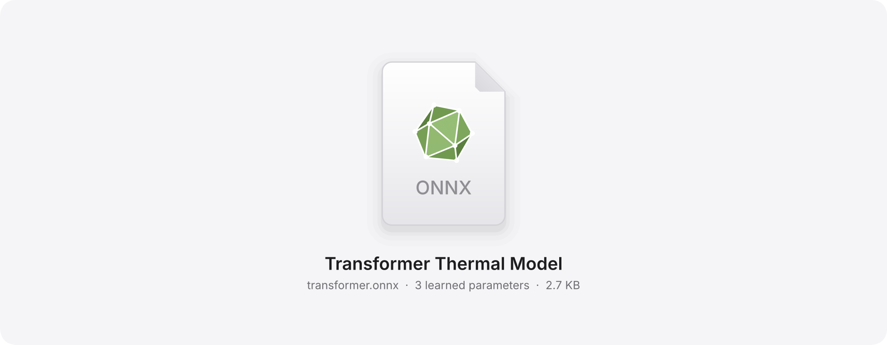
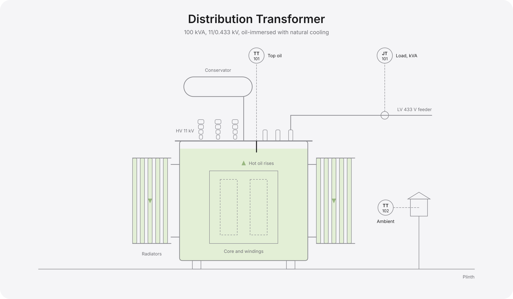
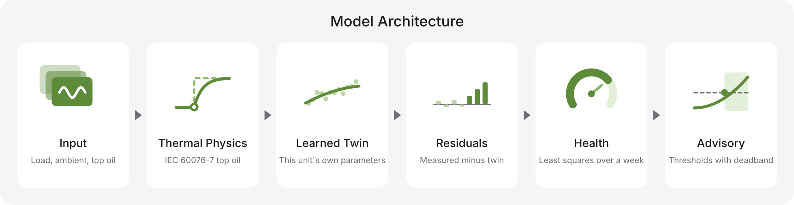
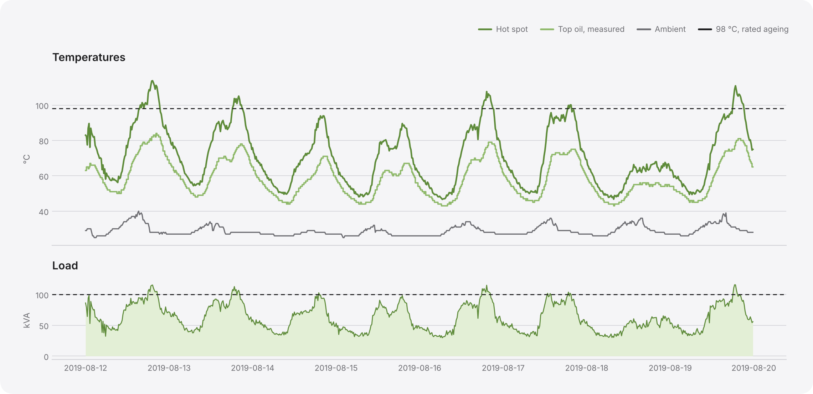
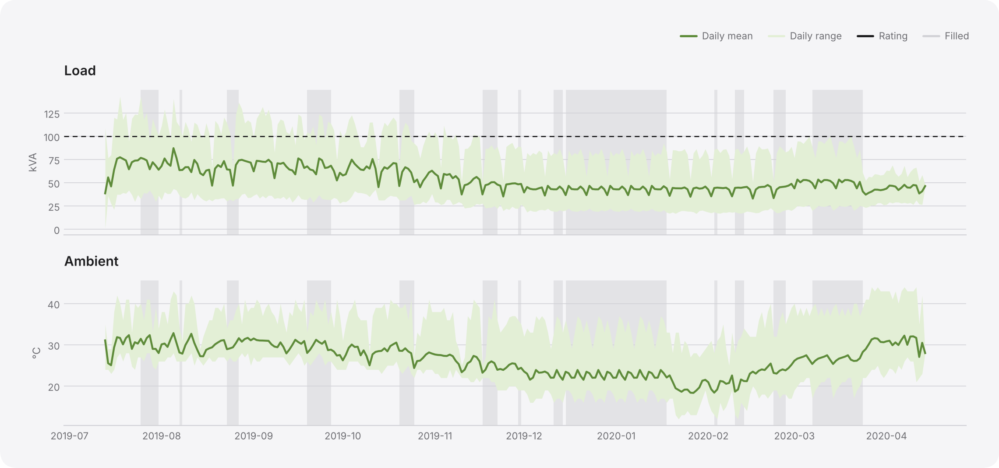
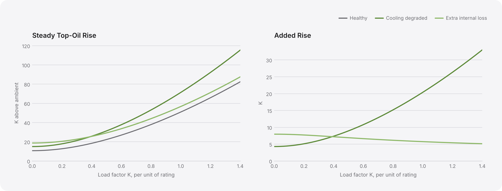
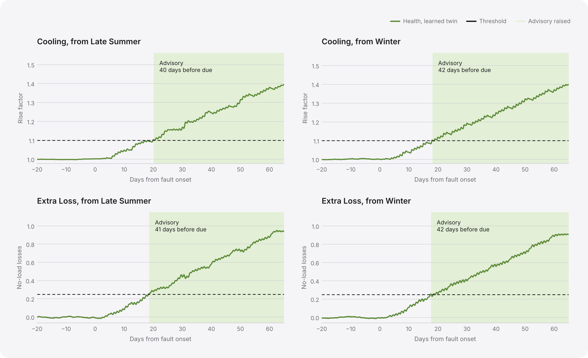
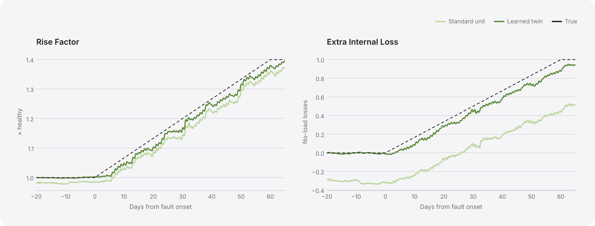
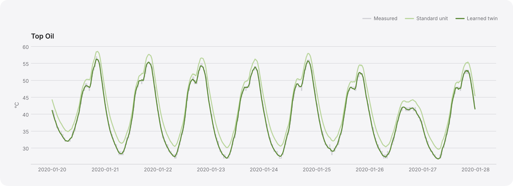

# Transformer Thermal Diagnosis

<picture>
  <source media="(prefers-color-scheme: dark)" srcset="docs/model-dark.png">
  
</picture>

Transformer Thermal Diagnosis watches an oil-immersed distribution transformer through the three readings a field monitor already logs: load, ambient temperature and top-oil temperature. It reports health in engineering units (how much hotter the oil runs than it should, how much heat the load does not explain, how fast the insulation is ageing) and raises one of three advisories: degraded cooling, extra internal heat or accelerated ageing. The model is the IEC 60076-7 thermal model, with three of its parameters learned from the unit's own first six weeks of oil temperature. Driven by a real field monitor's load and ambient record, it raises the right advisory 40 to 42 days before each fault is due for maintenance, with no false advisories over 7.8 healthy months, and runs in 0.01 ms per 15-minute step on one CPU thread.

## The Transformer

<p>
<picture>
  <source media="(prefers-color-scheme: dark)" srcset="docs/plant-dark.png">
  
</picture>
<br>
<sub><b>Distribution transformer.</b> Elevation view of a 100 kVA, 11/0.433 kV transformer with natural oil and air cooling (ONAN). Losses in the core and windings heat the oil, which rises, flows through the radiators and returns cooler at the bottom. Instruments carry their ISA-5.1 tags, and dashed lines are signals to the monitor.</sub>
</p>

A 100 kVA pole or plinth transformer feeds a low-voltage network. It is cooled by natural convection alone, so the oil temperature follows the load with a lag of a few hours, on top of the weather. A field monitor logs three values every 15 minutes.

| Tag | Measures | Used for |
| :-- | :-- | :-- |
| JT 101 | Load, kVA, from the LV power meter | Load factor $K$, and so the losses |
| TT 101 | Top-oil temperature, in whole degrees | The measured thermal response |
| TT 102 | Ambient temperature, in a shaded screen | What the oil cools towards |

## How It Works

<picture>
  <source media="(prefers-color-scheme: dark)" srcset="docs/architecture-dark.png">
  
</picture>

**Input.** Load, ambient and top oil, every 15 minutes.

**Thermal physics.** The IEC 60076-7 top-oil equation: from load and ambient, the oil temperature a healthy transformer would reach, step by step, with its thermal lag.

**Learned twin.** This unit's own rated oil rise, loss ratio and oil time constant, fitted to its first six weeks of healthy oil readings. The twin then runs alongside the transformer on the same load and ambient.

**Residuals.** Measured top oil minus the twin's. Each fault leaves its own shape in it.

**Health.** A least-squares fit of the residual to the two fault shapes over a week, giving the rise factor and the extra internal loss in engineering units. The hot spot follows from the measured oil and the load, and from it the insulation ageing rate.

**Advisory.** One rule per condition, with a threshold, a six-hour on-delay and a deadband.

## The Physics

Load losses grow with the square of the load factor $K$; no-load losses do not. Their ratio at rated load is $R$. The top oil heads for a steady rise above ambient

$$\Delta\theta_{o,ss} = \Delta\theta_{or}\left[\frac{1 + R\,K^2}{1 + R}\right]^{x}$$

where $\Delta\theta_{or}$ is the rise at rated load and $x$ the oil exponent. It approaches that rise as a first-order system with the oil time constant $\tau_o$:

$$\tau_o\,\frac{d\theta_o}{dt} = \theta_a + \Delta\theta_{o,ss} - \theta_o$$

which IEC 60076-7 writes as a difference equation, here at 15-minute steps. The winding hot spot sits above the top oil by

$$\theta_h = \theta_o + H g_r\,K^{y}$$

and settles within minutes, so at 15-minute steps it is taken as settled. Paper insulation ages at a relative rate that doubles every 6 K above 98 °C:

$$V = 2^{(\theta_h - 98)/6}$$

The standard's values for ONAN distribution transformers start the model: $\Delta\theta_{or} = 55$ K, $R = 5$, $x = 0.8$, $\tau_o = 180$ min, $H g_r = 25.3$ K, $y = 1.6$.

<p>
<picture>
  <source media="(prefers-color-scheme: dark)" srcset="reports/figures/thermal-dark.png">
  
</picture>
<br>
<sub><b>One summer week.</b> Load, ambient, measured top oil and the hot spot, 12 to 19 August 2019. The load passes the 100 kVA rating on five of the evenings, and the hot spot follows it past 98 °C, while the top oil follows the load with its thermal lag. The ambient is the field monitor's real reading.</sub>
</p>

## The Field Data

Load and ambient come from a real field monitor: the Distributed Transformer Monitoring dataset on Kaggle, logged every 15 minutes from July 2019 to April 2020 on a distribution transformer in India.

<p>
<picture>
  <source media="(prefers-color-scheme: dark)" srcset="reports/figures/inputs-dark.png">
  
</picture>
<br>
<sub><b>Field data.</b> Daily mean and range of load and ambient, 13 July 2019 to 14 April 2020. Load runs heaviest in late summer and passes the 100 kVA rating on many evenings. Ambient ranges from 44 °C at its hottest to 12 °C at its coolest. Shaded days are mostly filled from the week before, where the monitor logged nothing.</sub>
</p>

The transformer itself is simulated. The monitor's own oil temperature sits only 2.3 K above ambient on average and is logged in whole degrees, so the field unit never ran hot enough, or was measured finely enough, for its thermal parameters to be read back from it: fitted to that record, the IEC model predicted the oil no better than ambient plus a constant. Its winding temperature channel is an alarm flag, not a temperature. The simulated unit takes the real load on a 100 kVA rating and the real ambient, and its oil gauge reads in whole degrees, as the field monitor does.

## The Faults

| Fault | What changes | Physical cause | Severity 1 |
| :-- | :-- | :-- | :-- |
| Cooling | Every degree of rise grows by a factor $c$ | Fouled radiators, blocked fins, low oil | $c = 1.4$ |
| Extra internal loss | A loss $e$ joins the no-load loss: $1 + R K^2 + e$ | Core fault, circulating currents | $e = 1$ no-load loss |

<p>
<picture>
  <source media="(prefers-color-scheme: dark)" srcset="reports/figures/faults-dark.png">
  
</picture>
<br>
<sub><b>Fault signatures.</b> Steady top-oil rise against load factor, healthy and with each fault at severity 1, and the rise each fault adds. Degraded cooling adds rise in proportion to it, so it adds most at heavy load: 20 K at rated load. Extra internal loss adds 8 K with no load at all and relatively less as the load losses grow. The two faults are told apart by how their added rise moves with load.</sub>
</p>

## Where It Fits

The model is designed for an oil-immersed distribution transformer with a basic field monitor, whose cooling or internal condition drifts over weeks.

| The situation | The design |
| :-- | :-- |
| IEC 60076-7 describes the thermal behaviour of every oil-immersed transformer | The physics is the standard's, and only three parameters are learned |
| A unit rarely has a heat-run report on file, and its parameters drift from the standard's typical values | The twin learns them from six healthy weeks of its own oil readings |
| Load and weather change by the hour and the season | The twin runs on the measured load and ambient, so normal operation cancels out |
| Cooling and internal faults develop over weeks | Health is fitted over a week, and advisories wait six hours |
| Distribution transformers carry only a top-oil gauge, read in whole degrees | The week-long fit averages the rounding out |
| The field monitor has a modest CPU | One 15-minute step takes 0.01 ms |

Some situations call for a different design. Electrical faults that develop in seconds, such as a winding short, need protection relays, not trend diagnosis. Insulation chemistry, such as moisture or dissolved gases, shows first in an oil sample; the extra-loss advisory says when to take one. Large power transformers with forced cooling and several fan stages need the standard's extended model, with a cooling state per stage.

## How It Performs

The fault runs replay the whole field record, 13 July 2019 to 14 April 2020, through the simulated transformer. The simulated unit's rated oil rise is 51 K, its loss ratio 6 and its oil time constant 150 min, against the standard's 55 K, 5 and 180 min. The model never sees these numbers. Each fault grows to severity 1 over 60 days, once from late summer under heavy load and once from winter under light load. The healthy run, after the twin's six training weeks, counts false advisories.

| Fault run | Advisory raised | True health at the advisory | Standard unit, untrained |
| :-- | :-- | :-- | :-- |
| Cooling, from late summer | 40 days before due | Rise factor 1.13 (threshold 1.10) | 38 days, 1.15 |
| Cooling, from winter | 42 days before due | Rise factor 1.12 | 39 days, 1.14 |
| Extra loss, from late summer | 41 days before due | 0.31 no-load losses (threshold 0.25) | 15 days, 0.74 |
| Extra loss, from winter | 42 days before due | 0.29 no-load losses | 15 days, 0.74 |
| Healthy, 7.8 months | 0 false advisories | | 0 false advisories |

Only the right rule fired in each run. The ageing advisory was raised for 411 hours of the healthy run, 383 of them in the 423 hours when the true daily ageing rate was above 1.

<p>
<picture>
  <source media="(prefers-color-scheme: dark)" srcset="reports/figures/advisories-dark.png">
  
</picture>
<br>
<sub><b>Advisories.</b> The health parameter behind each rule through its four fault runs, the rule's threshold (dashed) and the period with the advisory raised (shaded). Each advisory comes within hours of the parameter crossing its threshold, 40 to 42 days before the fault reaches maintenance severity, in summer and in winter alike.</sub>
</p>

<p>
<picture>
  <source media="(prefers-color-scheme: dark)" srcset="reports/figures/health-dark.png">
  
</picture>
<br>
<sub><b>Health against the truth.</b> Each fault's health parameter through its late-summer run, estimated with the standard's typical unit and with the learned twin, against its true value (dashed). The standard unit runs 4 K hotter than this unit at rated load, which hides most of an extra loss: it reads the fault late and low, and its advisory comes when the fault is three-quarters grown. The learned twin follows both parameters to within a few percent.</sub>
</p>

## How It Was Built

**The dataset chosen by its physics.** The first candidate was ETT, the transformer dataset widely used for forecasting. Its oil temperature correlates with load at 0.06, its loads change sign and units partway through, it has no ambient, and the IEC model fitted to it predicted the second year worse than the mean. The Kaggle field monitor has real load and ambient but too little heating to identify. So the real inputs drive a simulated plant, and the README says so.

**Cleaning the field record.** The monitor logs zeros when it reboots and once an oil temperature of 250 °C. It also logged for nine days before the transformer carried any load, which made the two fault shapes identical and the first health estimates meaningless, so the timeline starts on the first loaded day. Gaps up to an hour are interpolated, and longer ones take the values from the same time a week earlier, flagged. A month-long gap over December and January makes 34% of the record filled.

**The learned twin.** Starting from the standard's values, the rated rise, loss ratio and oil time constant are fitted by least squares through the same difference equation the plant obeys, on the first 42 days. The oil exponent and hot-spot gradient stay at the standard's values: top-oil data alone cannot separate them from the other three.

| Parameter | Standard | Learned | True |
| :-- | :-- | :-- | :-- |
| Rated oil rise $\Delta\theta_{or}$ | 55 K | 51.0 K | 51 K |
| Loss ratio $R$ | 5 | 6.00 | 6 |
| Oil time constant $\tau_o$ | 180 min | 150 min | 150 min |
| Top-oil error, months unseen | 3.03 K | 0.42 K | |

The learned twin's error is the gauge's own: whole-degree rounding plus noise.

<p>
<picture>
  <source media="(prefers-color-scheme: dark)" srcset="reports/figures/twin-dark.png">
  
</picture>
<br>
<sub><b>The learned twin.</b> Measured top oil for a winter week the fit never saw, 20 to 27 January 2020, against the twin with the standard's typical parameters and with the learned ones. The standard unit runs 2 to 3 K hot all week; the learned twin follows the measured steps.</sub>
</p>

**Fault shapes from the equations.** The residual is linear in the cooling factor and, to first order, in the extra loss. Each fault's shape is its effect on the steady rise passed through the oil's own lag, $s_c = \text{filter}(\Delta\theta_{o,ss})$ and $s_e = \text{filter}(\partial\Delta\theta_{o,ss}/\partial e)$, so over a window

$$r \approx (c - 1)\,s_c + e\,s_e$$

and $c$ and $e$ are the least-squares solution of a 2×2 system, kept as five running sums. A week holds every load the unit sees, day and night, weekday and weekend, so the two shapes separate. On healthy data the rise factor stays within ±0.8% and the extra loss within ±0.03.

**Thresholds as maintenance criteria.** Cooling is worth inspecting when the oil runs 10% hotter than it should, an unexplained quarter of the no-load loss is worth an oil sample for gas analysis, and a day of hot spot above 98 °C uses more than a day of insulation life.

**An ONNX graph with state.** The twin is a recursive filter, so the graph takes the readings and the twin's state and returns the next state with the step's terms. It is written directly in ONNX operators through a small expression builder, `src/deployment/export.py`, and stepped through every run it matches the Python pipeline to 6 × 10⁻⁷ on health.

## How to Use It

The model is released in `models/` as `transformer.onnx` (2.7 KB), with the learned twin in `twin.json`. Running it needs NumPy and ONNX Runtime.

### Installation

```bash
git clone https://github.com/iamabdirazak/transformer-thermal-diagnosis.git
cd transformer-thermal-diagnosis
python3 -m venv .venv && source .venv/bin/activate
pip install -r requirements.txt
```

### Monitoring a Transformer

```python
from src.monitoring.monitor import Monitor

monitor = Monitor()                     # loads models/transformer.onnx and twin.json

while running:                          # every 15 minutes
    monitor.step({
        "load": 72.4,                   # kVA
        "ambient": 31.0,                # °C
        "oil": 58.0,                    # °C, top oil
    })
    print(monitor.health)               # after the first week
    print(monitor.advisories)           # updated hourly
```

For another transformer, the rating lives in `src/plant/transformer.py`, and the twin is refitted on the new unit's first healthy weeks with `python -m src.models.train`.

### Reproducing the Results

The field data comes from Kaggle, with a Kaggle API token in `~/.kaggle`:

```bash
pip install kaggle six
kaggle datasets download sreshta140/ai-transformer-monitoring -p data --unzip
```

```bash
python -m src.data.prepare              # clean load and ambient timeline
python -m src.data.simulate             # healthy and fault runs, into data/
python -m src.models.train              # learned twin
python -m src.evaluation.score          # advisories, into reports/results.json
python -m src.deployment.export         # models/transformer.onnx
python -m src.deployment.verify         # equivalence and latency
python -m pytest -q
for f in inputs thermal faults twin health advisories diagrams; do python -m src.visualization.$f; done
```

Everything runs on a CPU in under a minute.

## Limitations

- The transformer is simulated from IEC 60076-7. The load and ambient are real, but the oil temperature is not, and the faults are modelled as changes to the standard's parameters.
- A third of the field record is filled from the week before, including a month over December and January.
- The hot spot is computed, not measured, with the standard's gradient. A unit with a fibre-optic hot-spot sensor could learn its own.
- Each run holds one fault. Both together would move both parameters, which the fit separates but the rules have not been tested on.
- Times are measured on a general-purpose CPU, not on a field monitor.

## License

The code is released under the MIT License.

## Author

Abdirazak Mubarak, November 2026
